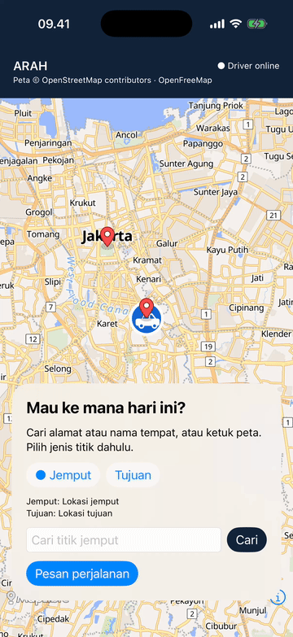
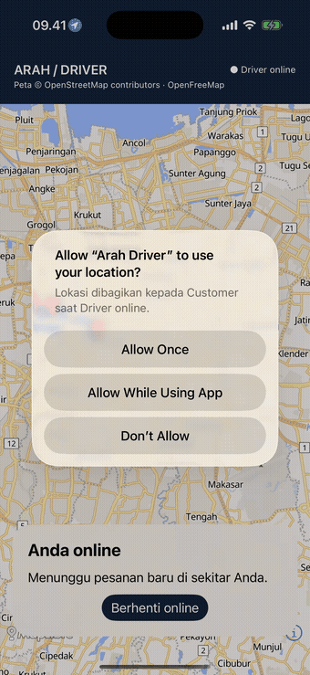
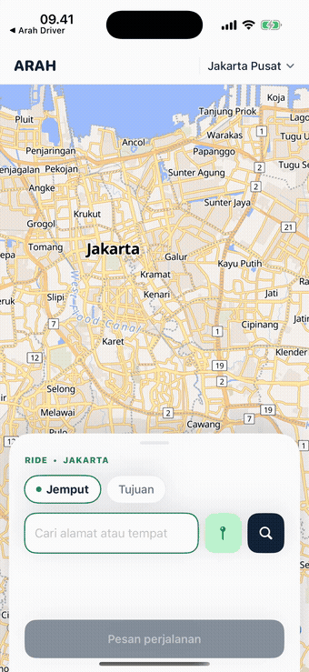
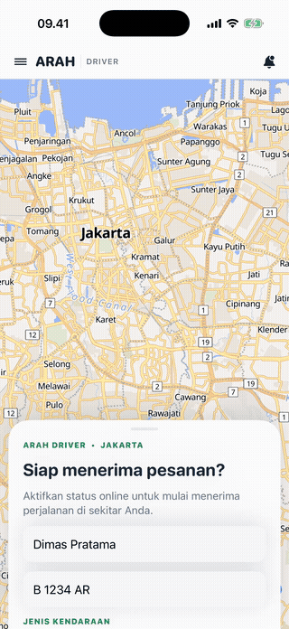

# ArahRide — Native iOS

A single Xcode project with two separate app targets:

- **ArahCustomer** (id.arahride.customer)
- **ArahDriver** (id.arahride.driver)

Both use SwiftUI for their screens, MapLibre MLNMapView through UIViewRepresentable for native maps, and URLSession for HTTP and WebSocket communication. The Driver app gets its location from Core Location while online. The car icon moves smoothly between location updates, and the **View Driver Location** button moves the Customer map to the latest location. The Driver target enables background location; iOS displays the location indicator as required by the system.
The map supports pinch-to-zoom gestures.

Preview: [Customer screen with the car icon](docs/live-car.png).

## Booking flow demo

The GIFs below show the **Customer** flow (placing a booking, finding a Driver, and tracking an active ride) and the **Driver** flow (going online, accepting a booking, arriving, verifying a PIN, and starting the ride) in the iOS Dev/Portfolio app:

<table>
  <tr>
    <td align="center" valign="top" width="50%">
       
      <b>Customer</b> — book and track a ride
    </td>
    <td align="center" valign="top" width="50%">
       
      <b>Driver</b> — go online, accept a booking, and complete a ride
    </td>
  </tr>
</table>

## Production version

The **Production** app has a more complete flow than Dev/Portfolio: OTP login with a phone number, service selection (motorcycle/car) and payment method selection (cash/non-cash), fare estimates, non-cash payments, ratings, and tips. This repository contains the **Dev/Portfolio** version. The clips below show the **Production Customer** and **Driver** apps for reference:

<table>
  <tr>
    <td align="center" valign="top" width="50%">
       
      <b>Production Customer</b> — order → ride → payment → tip
    </td>
    <td align="center" valign="top" width="50%">
       
      <b>Production Driver</b> — online → accept → arrive → PIN → ride
    </td>
  </tr>
</table>

## Tech stack

- **Language:** Swift
- **UI:** SwiftUI, with UIViewRepresentable wrapping the native map
- **Maps:** MapLibre Native (MLNMapView) with OpenFreeMap tiles (OpenStreetMap)
- **Networking:** URLSession — HTTP (REST) and WebSocket for live snapshots
- **Location:** Core Location (Driver), including background location
- **Project:** Generated from project.yml using XcodeGen → ArahRide.xcodeproj
- **Targets:** ArahCustomer, ArahDriver, ArahRideTests

## Getting started

1. Run [Arah Ride Backend Dev](https://github.com/alphadevthasa/arah-ride-backend-dev).
2. Open ArahRide.xcodeproj in Xcode. Run ArahDriver and ArahCustomer in the simulator; both can be installed at the same time.
3. Bring the Driver online, allow location access, then place an order from Customer and accept and complete it in Driver. For Jakarta simulation, set the simulator location near Jakarta.
4. If you change project.yml, run xcodegen generate again.

Terminal builds:

~~~sh
xcodebuild -project ArahRide.xcodeproj -scheme ArahCustomer -sdk iphonesimulator -destination 'generic/platform=iOS Simulator' build CODE_SIGNING_ALLOWED=NO
xcodebuild -project ArahRide.xcodeproj -scheme ArahDriver -sdk iphonesimulator -destination 'generic/platform=iOS Simulator' build CODE_SIGNING_ALLOWED=NO
~~~

The simulator API default is http://127.0.0.1:18080. The API URL and map style are configured in project.yml as ArahAPIBaseURL and ArahMapStyleURL; regenerate the project after changing them. For physical devices, use a reachable LAN hostname. For releases, use HTTPS and an OSM map host with an SLA or your own map hosting.

The demo map uses [OpenFreeMap](https://openfreemap.org/quick_start/) with OpenStreetMap data and visible attribution. This is a single-Driver, single-order prototype; the backend README describes server limitations and production features.

The demo backend retrieves road geometry from OSRM and displays it as a polyline on the map. When the Driver taps **Start Ride**, simulated location updates are sent every 100 ms for 16 seconds along the polyline; the Driver device's location updates are paused during the simulation.

## Place search verification results (2026-06-28)

- Automated: iOS: xcodebuild test -scheme ArahRideTests passed (18 tests); ArahCustomer and ArahDriver builds passed.
- With a local mock Photon server (ARAH_GEOCODER_URL), the backend mapped /v1/places/search and /v1/places/reverse results correctly; an empty query returned 400.
- **Not verified:** The public Photon service (photon.komoot.io) was unreachable from this machine during testing (the backend returned a generic 502), so real Indonesian address/POI search and production availability were not tested. End-to-end simulator testing (select a point, create an order, show the label in the Driver app, and tap the map) has not been run.
